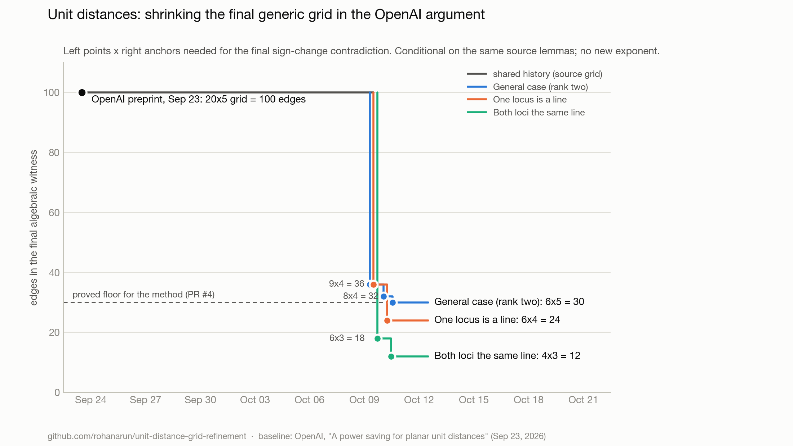

# Unit distances: reducing the final generic grid

An independent, AI-generated research draft prepared with Codex and Claude. We give a conditional reduction of the final algebraic grid in OpenAI's unit-distance argument from **20×5 to 6×5**, or 100 selected edges to 30, with smaller witnesses when a locus is a line.

**This does not improve the headline unit-distance exponent or provide an explicit power saving.** The original generic-grid extraction, negligible-height passage, and private-valuation arguments remain dependencies. Independent mathematical review, formal verification, and literature priority are not claimed.

| branch | grid | edges | previous version |
|---|---|---|---|
| neither locus is a line | 6×5 | 30 | 8×4 = 32 |
| general, by normalization alone | 8×4 | 32 | 9×4 = 36 |
| one locus is a line | 6×4 | 24 | 9×4 = 36 |
| both loci the same line | 4×3 | 12 | 6×3 = 18 |

A single 6×5 generic grid contains the 6×4 and 4×3 sub-grids, so one selection of thirty edges covers every case. **Thirty is also a floor:** no complete grid with fewer than 30 edges can work for any argument that uses only the algebraic hypotheses of the source's final section (see below).



## Argument

The source obtains equations

$$2(p_i-r_\ell)\cdot(H_i-U_\ell)=R_{i\ell}(A_i-A'_\ell),\qquad A_i-A'_\ell\ne0.$$

These are preserved by a five-dimensional group of transformations: translations and an infinitesimal rotation of all velocities (because $x\cdot Jx=0$), a common shift of all logarithmic velocities, and a common nonzero scaling of all velocity data (which multiplies both sides). The source's normalization already gives $A'_1=0$.

Let $J(x,y)=(-y,x)$, $v=r_2-r_1$, and $\omega=((U_2-U_1)\cdot Jv)/(v\cdot v)$. Subtracting $U_1$ and $\omega J(\cdot-r_1)$ from all velocities makes the first right velocity zero and the second parallel to $v$, say $\tau v$. **Scaling by $1/\tau$** (when $\tau\ne0$) then makes the second right velocity exactly $v$, which lies in the field already generated by the anchors. With four anchors the normalized right-hand data need only **seven field generators**: $3j-5$ in general.

Eight generic left points therefore guarantee a point surviving as generic after those generators are adjoined ($8d_1-7>8(d_1-1)$). The source's private valuations make the radical square classes independent; three equations determine the rank-two solution and changing the fourth radical's sign gives the contradiction. Seven left points would give equality and prove nothing.

## Collinear anchors: 24 edges

If either locus is a line, name the sides so the anchors lie on it: $r_\ell=r_1+\sigma_\ell v$. By the Leibniz rule $U_\ell-U_1=\sigma_\ell\,\partial v+(\partial\sigma_\ell)v$, and after the rotation step $\partial v-\omega Jv$ is parallel to $v$. So **every normalized anchor velocity is a scalar multiple of $v$**, costing one generator instead of two: $2j-3=5$ for $j=4$, hence six left points and a **6×4 grid, or 24 edges**.

## Common-line branch: 12 edges

If both loci are the same line, three anchors suffice for the two-unknown Cramer system and the third sign change, and the collinear count gives three generators. Four left points suffice: a **4×3 grid, or 12 selected edges**, conditional on the same generic-grid and private-valuation lemmas.

## Thirty edges without a surviving point

The normalization route cannot go below 32: its symmetry group is exactly five-dimensional, four anchors are forced, and the count $N>\text{cost}$ is sharp. The 30-edge result uses a different idea. Treat the velocity data of **all** $N+j$ grid vertices as unknowns of one homogeneous linear system: $Nj$ equations, $3(N+j)$ unknowns, and a four-dimensional trivial kernel (translations, rotation, common scalar shift). If the system has no other solutions, the actual data must have $A_i=A'_\ell$, a contradiction. That needs $Nj\ge 3(N+j)-4$, and $6\times5$ is the smallest grid satisfying it.

The rank bound splits by a spanning tree. Expanding a minor multilinearly in the thirty radicals $R_e$ (which are independent over the position field, by the source's private valuations applied once per left point), the coefficient of the tree monomial factors as a tree-incidence determinant times a minor of the **rigidity matrix** of the complete bipartite framework $K_{6,5}$ with the tree edges removed. The complement contains a $K_{4,3}$ core plus four vertices each attached by two edges, so its rank equals the core's rank plus eight. For the core we use Whiteley's kinematic form of the Bolker–Roth theorem: a complete bipartite framework whose sides span the plane has exactly as many nontrivial motions as there are conics through all its joints. Generic grid points on the loci are not on a conic unless both loci are the same conic, and in that case the one conic motion is explicit and still has constant scalar part. Either way the kernel is exactly the constant-scalar space.

This is the only place the note depends on an external theorem beyond the source. Both loci being lines is excluded here and covered by the 6×4 and 4×3 results.

## Why 30 cannot be beaten this way

The source's final section uses only four consequences of its hypotheses: the distance relation for each edge, rectangle constants in the constant field $k_0$, a derivation that is nonzero on every ratio, and generic positions. Configurations with prescribed rectangle constants form an algebraic family of dimension at least $2(N+j)-(N-1)(j-1)$; subtracting the three planar isometries leaves a genuine deformation exactly when $(N-3)(j-3)\le 4$, which includes every grid with fewer than 30 edges. Along that deformation every edge ratio varies (verified by an exact Jacobian computation over a finite field, which lifts to characteristic zero because the defining equations are monic in each ratio). Taking $k_0$ to be the constants of a derivation along the family gives a model in which all four hypotheses hold and no contradiction exists. So 6×5 is optimal among complete grids; going lower would need the height hypotheses beyond $k_0$, or a selection pattern other than a complete grid.

The full conditional proof is in [proof.tex](proof.tex). It compiles with `tectonic proof.tex`. No compiled PDF is bundled.

## Reproduce

Use Python 3.11 or 3.12:

```sh
python3 -m venv .venv
. .venv/bin/activate
python -m pip install -r requirements.txt
python -B run_checks.py
```

GitHub Actions runs the same command on pushes and pull requests. Do not enable Python optimization (`-O` or `PYTHONOPTIMIZE`); certificate assertions must remain active. The runner rejects optimized execution.

To regenerate the progress chart (needs `matplotlib`, not a test dependency): `python -B progress/make_chart.py`. The data behind it is [progress/progress.json](progress/progress.json); social-post drafts for each PR are in [progress/tweet.md](progress/tweet.md).

## What the tests establish

The twenty-five tests check symbolic invariance under translation, rotation and scaling; that the second velocity becomes exactly $v$ after scaling (1,000 seeded exact-rational proposals); that dilations are *not* a symmetry; the generator budgets 7, 5 and 3 together with the failing boundary counts 7, 5 and 3 left points; that collinear anchors give velocities parallel to the line (symbolic Leibniz rule plus 1,500 exact-rational proposals); the rank-two Cramer determinant's radical coefficients as two-by-two minors and the fourth-radical sign flip; the common-line Cramer solution, third-radical sign subtraction, and dependent-radical control; and, for the joint system, that the chosen spanning tree is spanning and avoids the core, the rigidity ranks 11/19 (generic) and 10/18 (on a circle) of the core, of $K_{6,5}$ and of $K_{6,5}$ minus the tree, the explicit conic motion, the two-edge attachment lemma, and that the full 30×33 system on exact rational data has rank 29 (generic) or 28 (circle) with every kernel vector having constant scalar part, while 7×4 does not; and the sharpness certificates: the dimension count, that every grid below 30 edges sits inside one of seven maximal shapes, that at an exact point over GF(1000003²) the fibre of the rectangle map is smooth and every ratio has a nonzero tangent for each maximal shape, and that for 6×5 and 8×4 the tangent space is exactly the isometries.

These are algebraic checks of the displayed reduction. They do not construct the generic grid, verify the source's ultraproduct lemmas, or prove a new incidence bound.

## Original source

OpenAI, [*A power saving for planar unit distances*](https://github.com/openai/math/tree/fd4aeeb2ee4fc729c18d98444fed42fd0529eeeb/preprints/A-power-saving-for-planar-unit-distances-September-23-2026), September 23, 2026, at commit [`fd4aeeb2ee4fc729c18d98444fed42fd0529eeeb`](https://github.com/openai/math/tree/fd4aeeb2ee4fc729c18d98444fed42fd0529eeeb). The relevant arguments are in the original algebra section: the generic grid, surviving point, private valuations, and final sign change.

[source-manifest.json](source-manifest.json) records the inspected source hash. Optionally retrieve it with `python -B fetch_sources.py --output upstream`; the tests themselves do not need a network connection once dependencies are installed. Credit for the original construction and imported lemmas belongs to OpenAI. This is not an official OpenAI publication.
