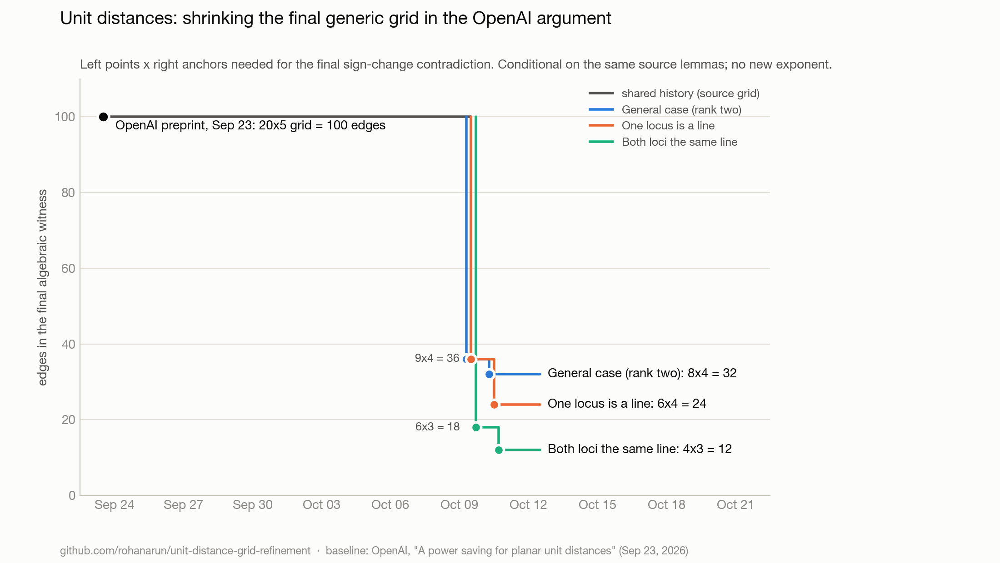

# Unit distances: reducing the final generic grid

An independent, AI-generated research draft prepared with Codex and Claude. We give a conditional reduction of the final algebraic grid in OpenAI's unit-distance argument from **20×5 to 8×4**, or 100 selected edges to 32, with smaller witnesses when a locus is a line.

**This does not improve the headline unit-distance exponent or provide an explicit power saving.** The original generic-grid extraction, negligible-height passage, and private-valuation arguments remain dependencies. Independent mathematical review, formal verification, and literature priority are not claimed.

| branch | grid | edges | previous version |
|---|---|---|---|
| general (rank two) | 8×4 | 32 | 9×4 = 36 |
| one locus is a line (rank two) | 6×4 | 24 | 9×4 = 36 |
| both loci the same line | 4×3 | 12 | 6×3 = 18 |

A single 8×4 generic grid contains the smaller sub-grids, so one selection covers every case.



## Argument

The source obtains equations

$$2(p_i-r_\ell)\cdot(H_i-U_\ell)=R_{i\ell}(A_i-A'_\ell),\qquad A_i-A'_\ell\ne0.$$

These are preserved by a five-dimensional group of transformations: translations and an infinitesimal rotation of all velocities (because $x\cdot Jx=0$), a common shift of all logarithmic velocities, and a common nonzero scaling of all velocity data (which multiplies both sides). The source's normalization already gives $A'_1=0$.

Let $J(x,y)=(-y,x)$, $v=r_2-r_1$, and $\omega=((U_2-U_1)\cdot Jv)/(v\cdot v)$. Subtracting $U_1$ and $\omega J(\cdot-r_1)$ from all velocities makes the first right velocity zero and the second parallel to $v$, say $\tau v$. **Scaling by $1/\tau$** (when $\tau\ne0$) then makes the second right velocity exactly $v$, which lies in the field already generated by the anchors. With four anchors the normalized right-hand data need only **seven field generators**: $3j-5$ in general.

Eight generic left points therefore guarantee a point surviving as generic after those generators are adjoined ($8d_1-7>8(d_1-1)$). The source's private valuations make the radical square classes independent; three equations determine the rank-two solution and changing the fourth radical's sign gives the contradiction. Seven left points would give equality and prove nothing.

## Collinear anchors: 24 edges

If either locus is a line, name the sides so the anchors lie on it: $r_\ell=r_1+\sigma_\ell v$. By the Leibniz rule $U_\ell-U_1=\sigma_\ell\,\partial v+(\partial\sigma_\ell)v$, and after the rotation step $\partial v-\omega Jv$ is parallel to $v$. So **every normalized anchor velocity is a scalar multiple of $v$**, costing one generator instead of two: $2j-3=5$ for $j=4$, hence six left points and a **6×4 grid, or 24 edges**.

## Common-line branch: 12 edges

If both loci are the same line, three anchors suffice for the two-unknown Cramer system and the third sign change, and the collinear count gives three generators. Four left points suffice: a **4×3 grid, or 12 selected edges**, conditional on the same generic-grid and private-valuation lemmas.

## Why it stops here

The symmetry group is exactly five-dimensional (dilations are not symmetries), so $3j-5$ is the floor for normalizing anchor data. Four anchors are forced in the rank-two case, and the counting $N>\text{cost}$ is sharp for the subadditivity argument. Choosing the derivation to kill anchor data was examined and gives no unconditional saving. See the last section of [proof.tex](proof.tex).

The full conditional proof is in [proof.tex](proof.tex). It compiles with `tectonic proof.tex`. No compiled PDF is bundled.

## Reproduce

Use Python 3.11 or 3.12:

```sh
python3 -m venv .venv
. .venv/bin/activate
python -m pip install -r requirements.txt
python -B run_checks.py
```

GitHub Actions runs the same command on pushes and pull requests. Do not enable Python optimization (`-O` or `PYTHONOPTIMIZE`); certificate assertions must remain active. The runner rejects optimized execution.

To regenerate the progress chart (needs `matplotlib`, not a test dependency): `python -B progress/make_chart.py`. The data behind it is [progress/progress.json](progress/progress.json); social-post drafts for each PR are in [progress/tweet.md](progress/tweet.md).

## What the tests establish

The thirteen tests check symbolic invariance under translation, rotation and scaling; that the second velocity becomes exactly $v$ after scaling (1,000 seeded exact-rational proposals); that dilations are *not* a symmetry; the generator budgets 7, 5 and 3 together with the failing boundary counts 7, 5 and 3 left points; that collinear anchors give velocities parallel to the line (symbolic Leibniz rule plus 1,500 exact-rational proposals); the rank-two Cramer determinant's radical coefficients as two-by-two minors and the fourth-radical sign flip; and the common-line Cramer solution, third-radical sign subtraction, and dependent-radical control.

These are algebraic checks of the displayed reduction. They do not construct the generic grid, verify the source's ultraproduct lemmas, or prove a new incidence bound.

## Original source

OpenAI, [*A power saving for planar unit distances*](https://github.com/openai/math/tree/fd4aeeb2ee4fc729c18d98444fed42fd0529eeeb/preprints/A-power-saving-for-planar-unit-distances-September-23-2026), September 23, 2026, at commit [`fd4aeeb2ee4fc729c18d98444fed42fd0529eeeb`](https://github.com/openai/math/tree/fd4aeeb2ee4fc729c18d98444fed42fd0529eeeb). The relevant arguments are in the original algebra section: the generic grid, surviving point, private valuations, and final sign change.

[source-manifest.json](source-manifest.json) records the inspected source hash. Optionally retrieve it with `python -B fetch_sources.py --output upstream`; the tests themselves do not need a network connection once dependencies are installed. Credit for the original construction and imported lemmas belongs to OpenAI. This is not an official OpenAI publication.
